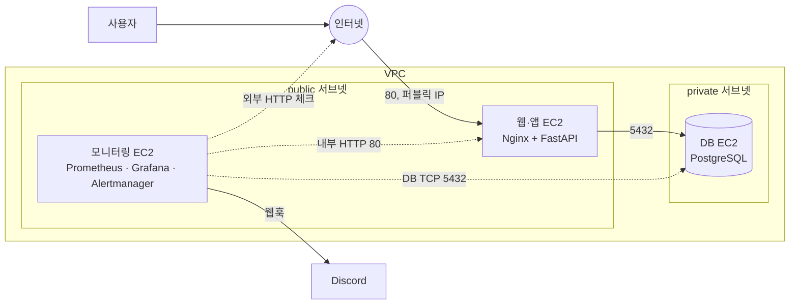

# AWS 네트워크·방화벽 장애 관제 프로젝트 계획서

## 프로젝트 개요

AWS에 3계층 웹 서비스(웹·앱, DB, 모니터링)를 Terraform으로 구축하고, 방화벽(SG·NACL) 장애와 앱 장애를 Prometheus·Grafana로 감지하고 원인을 좁혀 복구하는 실습 프로젝트다.

- **목적**: 서버관제·클라우드 운영 직무 지원용 포트폴리오. "발생 → 감지 → 원인 확인 → 복구 → 재발 방지" 흐름을 직접 재현하고 문서로 남긴다.
- **배경**: 이전 Terraform 실습과 Prometheus·Grafana 모니터링 실습을 복습하면서, 네트워크 분리와 계층별 방화벽을 새로 추가한다.
- **핵심 포인트**: 외부와 내부 두 지점에서 헬스체크해서 "앱 문제인지, 네트워크·방화벽 문제인지"를 그래프로 구분한다.
- **저장소**: 새 GitHub repo로 진행 (이름 미정).

## 목표와 범위

방화벽 장애 시나리오 2개를 재현하고 문서화하는 것까지를 1차 완성본으로 잡고, 나머지는 2차 확장으로 둔다.

**1차 최소 완성본**

- [ ] Terraform으로 VPC, 서브넷 2개(public/private), EC2 3대, 계층별 SG 구성
- [ ] 앱 배포 후 `/health`, `/metrics` 동작 확인
- [ ] Prometheus + node\_exporter + blackbox\_exporter + Grafana 대시보드 1개
- [ ] Alertmanager 알림 2개 이상 (서비스 다운, 5xx 증가)
- [ ] 장애 시나리오 2개(웹 SG 차단, 앱→DB 차단) 재현, 스크린샷, README 정리

**2차 확장**

- [ ] NACL 장애 시나리오 + VPC Flow Logs로 REJECT 확인
- [ ] Loki + Promtail로 앱 에러 로그 수집
- [ ] 부하 테스트(k6), 컨테이너·DB 중지, 디스크 풀 시나리오

범위 밖: 멀티 AZ·ALB·Auto Scaling 같은 고가용성 구성, HTTPS·도메인, CI/CD, 쿠버네티스.

## 아키텍처

VPC 하나에 public·private 서브넷을 두고, 웹·앱, DB, 모니터링 EC2 3대를 계층별 SG로 분리한다.



외부 체크는 퍼블릭 IP로 인터넷을 거쳐 들어오므로 웹 SG의 0.0.0.0/0 규칙이 막히면 실패하고, 내부 체크는 모니터링 SG 규칙으로 들어오므로 그대로 성공한다. 이 차이로 방화벽 문제와 앱 문제를 구분한다.

**SG 규칙 (인바운드)**

| SG | 포트 | 출처 | 용도 |
| --- | --- | --- | --- |
| 웹·앱 SG | 80 | 0.0.0.0/0 | 사용자·외부 체크 |
| 웹·앱 SG | 80, 8000, 9100 | 모니터링 SG | 내부 체크, 앱 메트릭, node\_exporter |
| 웹·앱 SG | 22 | 내 IP | SSH 관리 |
| DB SG | 5432 | 웹·앱 SG | 앱의 DB 접속 |
| DB SG | 5432, 9100 | 모니터링 SG | DB 체크, node\_exporter |
| DB SG | 22 | 웹·앱 SG | 점프 호스트 경유 SSH |
| 모니터링 SG | 3000 | 내 IP | Grafana 접속 |
| 모니터링 SG | 22 | 내 IP | SSH 관리 |

NACL은 처음에는 기본값(전체 허용)으로 두고, 2차 시나리오에서 규칙을 추가한다.

## 기술 스택

| 영역 | 사용 기술 | 비고 |
| --- | --- | --- |
| IaC | Terraform (AWS provider) | 기존 코드 복습, 모듈로 재구성 |
| 클라우드 | AWS VPC, EC2, Security Group, NACL | Flow Logs는 2차 |
| 앱 | Python FastAPI, PostgreSQL | 바이브 코딩, 코드 이해 정리 필수 |
| 배포 | Docker, Docker Compose, Nginx | user\_data로 자동 설치 |
| 모니터링 | Prometheus, node\_exporter, blackbox\_exporter, Grafana | 모니터링 전용 EC2 |
| 알림 | Alertmanager → Discord 웹훅 | Slack이나 이메일도 가능 |
| 로그 (2차) | Loki, Promtail | 메모리 여유 보고 결정 |
| 테스트 | curl, k6 | 부하 테스트는 2차 |

## 구성 요소별 상세

### Terraform

- 모듈 분리: `network`(VPC, 서브넷, 라우팅, NACL), `security`(SG), `compute`(EC2)
- 내 IP, 인스턴스 타입, 키 이름은 변수로 관리하고 `terraform.tfvars`는 커밋하지 않음
- EC2 `user_data`로 Docker 설치와 Compose 실행까지 자동화
- `outputs`로 각 서버 IP 출력, `apply` 한 번으로 전체 환경 재현

### 앱 (FastAPI)

- 엔드포인트: `GET /items`(DB 조회), `POST /items`(DB 저장), `/health`(DB 연결까지 확인, 실패 시 503), `/metrics`
- 메트릭: 경로·상태코드별 요청 수, 응답시간 히스토그램, DB 연결 에러 수
- Nginx가 80포트로 받아 앱 컨테이너로 전달
- 바이브 코딩으로 만들되, 각 파일 역할과 주요 코드를 README에 직접 설명할 수 있게 정리

### 모니터링

- Prometheus 수집 대상: node\_exporter(3대), 앱 `/metrics`, blackbox\_exporter
- blackbox 체크 3종: 외부 HTTP(웹 서버 퍼블릭 IP), 내부 HTTP(웹 서버 사설 IP), DB TCP 5432
- Grafana 대시보드 패널: 외부·내부·DB 체크 성공 여부, 5xx 비율, p95 응답시간, CPU·메모리·디스크

### 알림 규칙

| 알림 | 조건 | 의미 |
| --- | --- | --- |
| ServiceDownExternal | 외부 HTTP 체크 실패 1분 지속 | 사용자 입장에서 접속 불가 |
| ServiceDownInternal | 내부 HTTP 체크 실패 1분 지속 | 앱이나 서버 자체 문제 |
| DBUnreachable | DB TCP 체크 실패 1분 지속 | DB 서버나 DB 포트 문제 |
| High5xxRate | 5xx 비율 5% 이상 2분 지속 | 앱 내부 오류, DB 연결 실패 등 |
| DiskAlmostFull (2차) | 디스크 사용률 90% 이상 | 디스크 풀 위험 |

### VPC Flow Logs (2차)

- public 서브넷 Flow Logs를 CloudWatch Logs로 보내 방화벽에 막힌 트래픽(`REJECT`)을 원인 확인 증거로 사용

## 장애 시나리오

1차는 1·2번만 완성하고, 시나리오마다 "발생 → 감지 → 원인 확인 → 복구 → 재발 방지"를 스크린샷과 함께 README에 남긴다.

| # | 시나리오 | 발생 방법 | 감지 신호 | 원인 확인 | 복구 | 단계 |
| --- | --- | --- | --- | --- | --- | --- |
| 1 | 웹 SG 80포트 차단 | 웹 SG에서 0.0.0.0/0 인바운드 80 규칙 삭제 | 외부 체크 실패, 내부 체크 정상 | 앱은 정상 → 외부 경로 문제 → SG 규칙 확인 | `terraform apply`로 원래 규칙 복구 (drift 확인) | 1차 |
| 2 | 앱→DB 경로 차단 | DB SG에서 앱 SG 출처의 5432 규칙 삭제 | `/health` 503, 5xx 급증, DB TCP 체크는 정상 | DB는 살아 있음 → 앱↔DB 사이 방화벽 문제 | `terraform apply`로 복구 | 1차 |
| 3 | 앱 컨테이너 중지 | `docker stop` | 외부·내부 체크 모두 실패, node\_exporter 정상 | 서버는 정상 → 프로세스 문제 → `docker ps` | 컨테이너 재시작, restart 정책 추가 | 2차 |
| 4 | DB 중지 | DB 서비스 중지 | DB TCP 체크 실패, `/health` 503 | DB 서버 접속 후 서비스 상태 확인 | DB 재시작 | 2차 |
| 5 | NACL 아웃바운드 차단 | public 서브넷 NACL에서 아웃바운드 1024\~65535 거부 | 외부 체크 실패, SG는 정상 | SG만 봐서는 안 보임 → NACL이 stateless라 응답이 막힘 → Flow Logs `REJECT` | NACL 규칙 복구 | 2차 |
| 6 | 부하 증가 | k6로 동시 요청 | p95 응답시간·CPU 상승 | 대시보드에서 자원 사용률 확인 | 부하 중지, 인스턴스 크기 검토 | 2차 |
| 7 | 디스크 풀 | 큰 파일 생성(`fallocate`) | DiskAlmostFull 알림 | `df -h`, `du`로 원인 파일 확인 | 파일 정리, 로그 로테이션 설정 | 2차 |

## 단계별 일정

평일 저녁과 주말 기준으로 약 3주 안에 1차 완성본을 끝내고, 그 뒤에 2차 확장을 붙인다.

1. **1주차 — 인프라와 앱 뼈대**
   - 아키텍처·SG 규칙 확정, Terraform으로 VPC·서브넷·EC2·SG 생성
   - 앱 바이브 코딩, 로컬에서 Docker Compose로 실행 확인
2. **2주차 — 배포와 모니터링**
   - user\_data로 AWS에 앱 배포, 외부 접속 확인
   - Prometheus·blackbox·Grafana 구성, 대시보드 1개, 알림 2개
3. **3주차 — 장애 재현과 문서화 (1차 완성)**
   - 시나리오 1·2 재현, 알림 수신과 대시보드 스크린샷
   - README 1차 작성, repo public 전환
4. **4주차 이후 — 2차 확장**
   - NACL·Flow Logs, Loki, 나머지 시나리오를 하나씩 추가

시작일과 1차 완성 목표일은 아직 정하지 않았다.

## 비용 관리

작업할 때만 띄우고 끝나면 `terraform destroy`하는 것이 기본 원칙이다.

- **인스턴스**: 웹·앱과 DB는 t3.micro, 모니터링 서버는 메모리 여유를 위해 t3.small 검토
- **NAT Gateway 사용 안 함**: private DB 서버에 패키지 설치가 필요하면 그때만 잠깐 만들고 지우거나, 작은 NAT 인스턴스로 대체
- **퍼블릭 IPv4 최소화**: 웹 서버와 모니터링 서버 2개만 퍼블릭 IP 부여 (퍼블릭 IP에도 시간당 요금이 붙음)
- **로그 보존 기간**: Flow Logs·CloudWatch Logs는 보존 기간을 짧게 설정
- **예산 알림**: 시작 전에 AWS Budgets로 소액 월 예산 알림 설정
- **습관**: 작업 종료 시 `terraform destroy`, 다음 작업 때 `apply`로 재생성

## 산출물과 면접 활용

최종 산출물은 GitHub repo 하나이고, README가 장애 대응 보고서 역할을 한다.

**repo 구조 (안)**

```
├─ terraform/
│   ├─ modules/ (network, security, compute)
│   ├─ main.tf, variables.tf, outputs.tf
│   └─ user_data/
├─ app/ (FastAPI, Dockerfile, docker-compose.yml, nginx.conf)
├─ monitoring/ (prometheus.yml, alert rules, blackbox.yml, alertmanager.yml, grafana 대시보드 JSON)
├─ docs/
│   ├─ architecture.png
│   └─ incidents/ (시나리오별 보고서 + 스크린샷)
└─ README.md
```

**README 목차**

1. 프로젝트 개요와 아키텍처 그림
2. 실행 방법 (`terraform apply`부터 대시보드 접속까지)
3. 모니터링 구성과 대시보드 스크린샷
4. 장애 시나리오별 보고서: 발생 → 감지 → 원인 확인 → 복구 → 재발 방지
5. 배운 점과 개선할 점

**면접에서 쓸 포인트**

- 외부·내부 두 지점에서 체크해 "앱 문제 vs 네트워크 문제"를 구분한 설계 이유
- SG(stateful)와 NACL(stateless)의 차이를 장애로 직접 확인한 경험
- 수동으로 바꾼 방화벽 규칙을 `terraform apply`로 되돌리며 IaC로 설정 drift를 복구한 경험
- 앱은 AI 도움을 받아 만들었고, 인프라·모니터링·장애 대응은 직접 설계했다고 솔직하게 설명

## 리스크와 대응

| 리스크 | 대응 |
| --- | --- |
| 평일 수업으로 일정 지연 | 1차 범위만 먼저 끝내고 2차는 하나씩 추가 |
| 바이브 코딩 코드를 설명 못 함 | 앱 기능을 최소로 유지, 파일별 역할과 핵심 코드를 직접 주석·정리 |
| AWS 비용 초과 | 작업 후 destroy, NAT Gateway 미사용, Budgets 알림 |
| 모니터링 서버 메모리 부족 | t3.small 사용, 부족하면 Loki 제외 |
| SG 실수로 내 SSH 접속 끊김 | SSH는 내 IP만 허용하는 별도 규칙 유지, 필요하면 SSM Session Manager 사용 |
| 키·웹훅 URL 유출 | `.gitignore`에 tfvars·키·`.env` 추가, Discord 웹훅 URL은 변수로 분리 |
