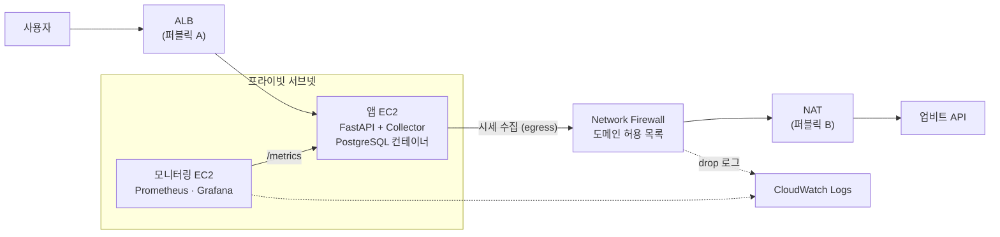

# AWS 네트워크 장애 관제 랩

코인 시세 수집·조회 서비스를 AWS에 올리고, **네트워크·방화벽·앱에서 생기는 장애를 모니터링으로 감지하고 원인을 구분**하는 실습 프로젝트다.

- **목적**: 서버관제·클라우드 운영 직무 지원용 포트폴리오. "발생 → 감지 → 원인 확인 → 복구 → 재발 방지" 흐름을 직접 재현하고 문서로 남긴다.
- **핵심 포인트**: 앱은 살아 있는데 시세 수집만 멈췄을 때, 원인이 **방화벽 차단**인지 **외부 API 장애**인지 **앱 자체 문제**인지를 지표 조합으로 가른다.
- **데이터 소스**: 업비트 공개 시세 API(`api.upbit.com`). 키 없이 쓸 수 있고 24시간 시세가 움직여서 언제 테스트해도 데이터가 바뀐다. 코인은 데이터 소스일 뿐이고, 보여주고 싶은 것은 인프라와 관제다.

## 설계 문서

| 문서 | 내용 |
| --- | --- |
| [아키텍처 설계](docs/architecture.md) | 컴포넌트, 네트워크·라우팅, 데이터 흐름, 장애 분류·메트릭·알림, 배포 구성 |
| [API 명세](docs/api.md) | 엔드포인트, 응답 형식, 오류 코드, 부하 테스트 시나리오 |
| [데이터 모델](docs/erd.md) | ERD, 테이블 정의서, 제약 조건, 보관 정책 |

## 아키텍처 요약



- 조회 요청은 ALB에서 앱으로 바로 들어오고, **외부로 나가는 수집 트래픽만 방화벽을 거친다.** 방화벽 규칙을 바꾸면 조회는 살아 있고 수집만 멈추는 장애를 만들 수 있다.
- 앱·모니터링 서버는 프라이빗 서브넷에 두고 SSH 대신 **SSM Session Manager**로 접속한다. Grafana는 SSM 포트 포워딩으로 연다.
- 모든 인프라는 Terraform으로 만들고 지운다. 콘솔에서 수동으로 바꾸지 않는다.

## 장애 시나리오

| 유형 | 재현 방법 | 감지 신호 |
| --- | --- | --- |
| 네트워크 차단 | 허용 목록에서 `api.upbit.com` 제거 | 수집 실패 `timeout`·`connect_error` + 방화벽 drop 로그, 앱 `up=1` |
| 외부 API 장애 | 잘못된 엔드포인트, 과다 호출(429) | 수집 실패 `http_error`, drop 없음 |
| 앱 장애 | 컨테이너 중지, 예외 주입 | `up=0` 또는 5xx 급증 |
| 데이터 장애 | 응답 파싱 실패 | 수집 실패 `parse_error` |
| 성능 저하 | 부하 테스트로 동시 사용자 증가 | p95 지연 상승 |

시나리오마다 "발생 → 감지 → 원인 확인 → 복구 → 재발 방지"를 스크린샷과 함께 `docs/incidents/`에 남긴다. 판별 기준과 알림 규칙은 [아키텍처 설계 5장](docs/architecture.md#5-장애-분류와-감지-기준)에 있다.

## 기술 스택

| 영역 | 사용 기술 |
| --- | --- |
| IaC | Terraform (AWS provider) |
| 네트워크 | VPC, 서브넷·라우팅, IGW, NAT Gateway, ALB, Security Group |
| 방화벽 | AWS Network Firewall (egress 도메인 허용 목록) |
| 앱 | Python FastAPI, PostgreSQL (Docker Compose) |
| 모니터링 | Prometheus, Grafana (알림 포함), CloudWatch Logs 데이터 소스 |
| 접속·비밀 값 | SSM Session Manager, SSM Parameter Store |
| 부하 테스트 | k6 또는 Locust |

## 진행 현황

**MVP**

- [x] 앱 뼈대 로컬 실행 (Docker Compose, `/`·`/health`·`/metrics`) — [실행 기록](docs/images/local-run/)
- [x] Terraform: VPC, 서브넷, IGW, NAT(토글), 라우팅, SG, EC2
- [ ] Terraform을 설계 기준으로 재구성: 퍼블릭 A/B 분리, 방화벽 서브넷, 앱·모니터링을 프라이빗으로, DB EC2 제거, SSH → SSM
- [ ] ALB (리스너 규칙 `/api/*`·`/`만 앱으로)
- [ ] Network Firewall: 허용 목록, CloudWatch 로깅
- [ ] 앱: Collector, `/api/v1` 조회 API, 수집 메트릭, 스키마([erd.md](docs/erd.md))
- [ ] Prometheus·Grafana 대시보드, CloudWatch drop 지표 연동, 알림
- [ ] 장애 재현 4종과 보고서
- [ ] 부하 테스트로 정상 기준선 측정, 알림 임계값 확정

**추후 확장**: Collector 별도 컨테이너 분리, RDS 전환, Loki 중앙 로그, Multi-AZ 방화벽 엔드포인트, ALB 앞 WAF

**범위 제외**: 로그인·회원, 거래 기능, 인바운드 트래픽의 방화벽 검사, Multi-AZ

## 저장소 구조

```
├─ terraform/
│   ├─ modules/
│   │   ├─ network/        VPC·서브넷·IGW·NAT·라우팅
│   │   ├─ security/       Security Group
│   │   ├─ compute/        EC2
│   │   ├─ alb/            (예정)
│   │   ├─ firewall/       (예정) 정책·규칙 그룹·로깅
│   │   └─ observability/  (예정) 로그 그룹·메트릭 필터
│   └─ main.tf, variables.tf, outputs.tf, version.tf
├─ app/          FastAPI, Dockerfile, docker-compose.yml, nginx.conf
├─ monitoring/   (예정) Prometheus 설정·알림 규칙, Grafana 대시보드
└─ docs/         설계 문서, 장애 보고서, 스크린샷
```

## 실행 방법

### 앱 로컬 실행

```bash
cd app
cp .env.example .env   # 값 채우기
docker compose up -d --build
curl localhost:8000/health
```

### 인프라

```bash
cd terraform
terraform init
terraform apply
terraform destroy   # 작업이 끝나면 반드시
```

`terraform.tfvars`는 커밋하지 않는다. 접속은 SSM으로 바꾸는 중이며, 현재 코드는 아직 key pair + SSH 접속을 쓴다. SSM 전환이 끝나면 접속 방법을 이 절에 적는다.

## 비용 관리

작업할 때만 띄우고 끝나면 `terraform destroy`하는 것이 기본 원칙이다.

- **Network Firewall·NAT Gateway**: 둘 다 시간당 요금과 처리량 요금이 붙고 EC2보다 훨씬 비싸다. 실습할 때만 올린다.
- **ALB**: 시간당 요금이 붙는다.
- **인스턴스**: 앱은 t3.micro, 모니터링은 메모리 여유를 위해 t3.small.
- **로그 보존 기간**: CloudWatch Logs 보존 기간을 짧게 둔다.
- **예산 알림**: AWS Budgets로 소액 월 예산 알림을 설정한다.

## 열린 질문

- [ ] 수집 간격 10초 vs 30초 — 업비트 호출 제한과 NAT·방화벽 처리량 비용 확인 후 결정
- [ ] 수집 대상 코인 개수
- [ ] SSM 접근: 허용 목록에 SSM 도메인 추가 vs VPC 인터페이스 엔드포인트

## 만든 방식

앱(FastAPI)은 AI 도움을 받아 작성했고, 메트릭 설계와 코드 리뷰는 직접 했다. 인프라·네트워크·방화벽·모니터링·장애 대응은 직접 설계하고 구현했다.
