# 앱 구현 보고서

> 작성일: 2026-11-15 · 기준 문서: [아키텍처 설계](architecture.md) · [API 명세](api.md) · [데이터 모델](erd.md)

설계 문서를 기준으로 `app/`(시세 수집·조회 서비스)을 새로 만든 과정과 결과를 정리한다. 앱 코드는 AI(Claude Code)가 작성했고, 이 문서는 무엇을 왜 그렇게 만들었는지, 어떻게 검증했는지를 남기기 위한 기록이다.

## 1. 시작 상태

| 항목 | 기존 앱 | 설계 문서 |
| --- | --- | --- |
| 구조 | `main.py` 한 파일 | Collector와 API Server를 코드·메트릭 수준에서 분리 |
| 엔드포인트 | `/`, `/health`, `/metrics` | `/api/v1/*` 5개 + `/`, `/health`, `/ready`, `/metrics` |
| 테이블 | `prices` (market, trade_price, collected_at) | `markets`, `collect_runs`, `price_ticks` |
| 메트릭 | 기본 프로세스 메트릭만 (TODO) | 수집·조회 메트릭 6종 |
| `/health` | DB 연결까지 확인 | 프로세스 생존만 (DB는 `/ready`) |

## 2. 구현 결과

### 2.1 파일 구성

```
app/
├─ main.py          진입점: 수집 시작, 요청 메트릭, 오류 응답 형식, /, /health, /ready, /metrics
├─ api.py           /api/v1 조회 API
├─ collector.py     주기 수집, 실패 사유 분류, 저장, 보관 기간 정리
├─ status.py        수집 상태 판정 (OK·DELAYED·FAILED·RECOVERED)
├─ db.py            커넥션 풀과 모든 SQL
├─ schema.sql       테이블·제약 조건·인덱스·초기 코인
├─ metrics.py       Prometheus 메트릭 정의
├─ config.py        환경변수 설정, 장애 재현용 값
├─ static/index.html  프론트 (CSS·JS 내장)
└─ tests/           단위 테스트 46개
```

파일을 책임별로 나눈 이유는 설계의 "나중에 Collector를 별도 컨테이너로 분리" 때문이다. `collector.py`는 API 코드를 import하지 않고, `api.py`는 외부 API를 부르지 않는다. 둘은 DB(`collect_runs`, `price_ticks`)로만 이어진다.

### 2.2 수집 흐름

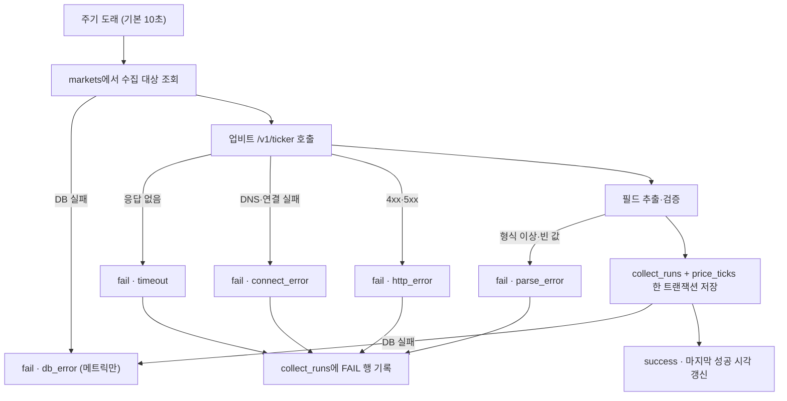

- 실패 사유는 메트릭 레이블 `reason`과 `collect_runs.reason`에 같은 값으로 남는다. 장애 원인 판별(설계 5.1)의 근거가 된다.
- 시작 간격을 일정하게 유지하려고, 수집에 걸린 시간을 빼고 다음 주기까지 기다린다.
- 같은 `(market_code, exchange_ts)` 시세는 거래가 없어 값이 바뀌지 않은 것이므로 건너뛰고, 실제로 저장한 행 수를 `saved_count`에 남긴다.
- 보관 정책(시세 7일, 수집 이력 30일)은 시작 시 한 번, 이후 하루마다 정리한다. FK가 RESTRICT라서 시세를 먼저 지운다.

### 2.3 수집 상태 판정

설계 7.4의 상태도를 그대로 따르되, 상태를 메모리에 두지 않고 매번 `collect_runs`의 최근 성공 시각으로 다시 계산한다.

| 조건 (수집 주기 10초 기준) | 상태 |
| --- | --- |
| 마지막 성공 후 40초(4배) 이상 | FAILED |
| 마지막 성공 후 20초(2배) 이상 | DELAYED |
| 최근 3번의 성공 사이에 40초 이상 벌어진 구간이 있음 | RECOVERED |
| 그 외 | OK |
| 성공 기록 없음 | 첫 수집 후 40초 전까지 DELAYED, 이후 FAILED |

`stale`은 DELAYED·FAILED일 때 `true`다. RECOVERED는 데이터가 다시 들어오고 있으므로 `false`다.

### 2.4 오류 응답

명세 3장의 형식(`{"error": {"code", "message"}}`)을 모든 오류에 적용했다.

| 상황 | 처리 |
| --- | --- |
| 쿼리 파라미터 오류 | FastAPI 기본 422를 400 `INVALID_PARAMETER`로 바꿈 |
| 수집 대상이 아닌 마켓 | 404 `MARKET_NOT_FOUND` |
| DB 연결 실패·풀 대기 초과 | 503 `DB_UNAVAILABLE` |
| 그 외 예외 | 500 `INTERNAL_ERROR` |
| 없는 경로 | 404 `NOT_FOUND` (명세에 없어서 추가) |

수집이 멈춰도 조회는 200 + `stale: true`로 응답한다. 5xx 알림과 수집 알림이 섞이지 않게 하기 위함이다.

### 2.5 메트릭

| 메트릭 | 구현 메모 |
| --- | --- |
| `collector_fetch_total{result, reason}` | 시작 시 모든 사유를 0으로 만들어 둠. 한 번도 실패하지 않은 사유도 그래프에서 0으로 보인다 |
| `collector_fetch_duration_seconds` | 실패한 호출도 기록 (timeout이면 타임아웃 근처 값) |
| `collector_last_success_timestamp` | 재시작 직후 0으로 보여 알림이 잘못 뜨지 않게, 시작 시 DB의 마지막 성공 시각으로 채움 |
| `http_requests_total{path, status}` | `path`는 실제 URL이 아니라 라우트 템플릿(`/api/v1/prices/{market}`). URL을 그대로 쓰면 `KRW-NOPE` 같은 값마다 시계열이 생긴다 |
| `http_request_duration_seconds{path}` | 위와 같은 레이블 |
| `up{job="app"}` | Prometheus가 만든다. 앱 코드 없음 |

### 2.6 장애 재현용 설정

`.env`만 바꾸고 컨테이너를 다시 띄우면 된다. 네트워크 차단은 방화벽에서 재현하므로 앱 설정이 필요 없다.

| 재현할 장애 | 설정 | 기대 결과 |
| --- | --- | --- |
| 외부 API 장애 | `UPBIT_TICKER_PATH=/v1/ticker-wrong` | `http_error`, http_status 404 |
| 데이터 장애 | `UPBIT_TICKER_PATH=/v1/market/all` | `parse_error` (시세 필드가 없는 응답) |
| 앱 장애 (5xx 급증) | `FAULT_API_ERROR_RATE=0.3` | `/api/v1` 요청 중 약 30%가 500 |

## 3. 설계와 다르게 구현했거나 설계에 없던 결정

| # | 내용 | 이유 |
| --- | --- | --- |
| 1 | 실패 사유에 `db_error` 추가 (메트릭에만) | 시세는 받았는데 DB에 저장하지 못한 경우가 설계의 사유 4개에 들어맞지 않는다. DB가 죽은 상황이라 `collect_runs`에는 기록할 수 없다 |
| 2 | 수집 상태를 DB에서 매번 계산 | 재시작해도 상태가 이어지고, Collector·API를 나눠도 API가 같은 결과를 낸다. 근거 데이터(`collect_runs`)는 Collector만 쓴다 |
| 3 | `change_rate`에 업비트 `signed_change_rate` 저장 | 업비트 `change_rate`는 절댓값이라 상승·하락을 구분할 수 없다 |
| 4 | 시간대 정보가 없는 `from`·`to`는 UTC로 해석 | 명세에 정해져 있지 않음 |
| 5 | `/api/v1/prices/{market}` 응답을 `{"collector", "item"}`으로 정함 | 명세에 응답 예시가 없음. 목록 응답과 같은 필드를 쓴다 |
| 6 | 초기 수집 대상 5개 (BTC, ETH, XRP, SOL, DOGE) | 코인 개수는 아직 열린 질문. `markets.is_active`로 바꿀 수 있다 |
| 7 | 기존 `prices` 테이블은 지우지 않음 | 데이터 삭제는 직접 판단할 일 |
| 8 | `nginx.conf`는 건드리지 않음 | compose에서 쓰지 않고, 설계상 ALB가 경로 제한을 맡는다 |

## 4. 검증

### 4.1 단위 테스트 (46개 통과)

| 파일 | 확인한 것 |
| --- | --- |
| `test_status.py` | 상태 전이 경계값 (2배·4배), RECOVERED → OK 전환, 성공 기록이 없을 때 |
| `test_collector.py` | 실패 사유 분류 (타임아웃·연결 실패·4xx/5xx·JSON 아님·빈 값·0원 등), 성공·실패 시 DB 기록과 메트릭 증가 |
| `test_api.py` | 응답 형식, 400·404·500·503 오류 형식, `/health`는 DB를 보지 않음, 메트릭 `path` 레이블 |

```bash
pip install -r requirements-dev.txt
python -m pytest -q
```

### 4.2 실제 PostgreSQL + 업비트 API로 실행

Docker가 없는 환경이라, pip로 설치하는 임시 PostgreSQL(`pgserver`)을 띄우고 uvicorn으로 직접 실행했다. 수집 주기는 5초로 줄였다.

| 확인 항목 | 결과 |
| --- | --- |
| 스키마 생성·초기 코인 등록 | 정상 |
| 수집 | 5초마다 성공, 30ms 안팎, 코인 5개 저장 |
| `/api/v1` 엔드포인트 5개 | 명세 형식대로 응답 (가격 문자열, UTC `Z` 시각) |
| `KRW-NOPE`, `limit=0` | 404 `MARKET_NOT_FOUND`, 400 `INVALID_PARAMETER` |
| DB가 없을 때 | `/health` 200, `/ready`·조회 API 503 `DB_UNAVAILABLE`, 앱은 죽지 않음 |
| 잘못된 경로 | `http_error`, http_status 404 |
| `/v1/market/all` | `parse_error`, http_status 200 |
| 응답 없는 주소 (방화벽 drop 흉내) | `timeout` |
| 수집 실패 지속 | 8초 뒤 DELAYED, 25초 뒤 FAILED, `stale: true`, 조회는 200 유지 |
| 정상 복구 | 3초 뒤 RECOVERED, 15초 뒤 OK |
| `FAULT_API_ERROR_RATE=0.5` | 요청 20건 중 500이 9건, 메트릭에 그대로 집계 |
| 프론트 | 시세 5개, 수집 상태, KST 시각, 10초 자동 갱신 |

### 4.3 실행 화면

로컬 실행 환경(수집 주기 5~10초)에서 정상 수집 → 외부 API 장애 → 복구 흐름을 캡처했다. 프론트 화면은 카드·꺾은선 그래프·상태 배너로 다시 만든 뒤 찍은 것이다.

**정상 수집**

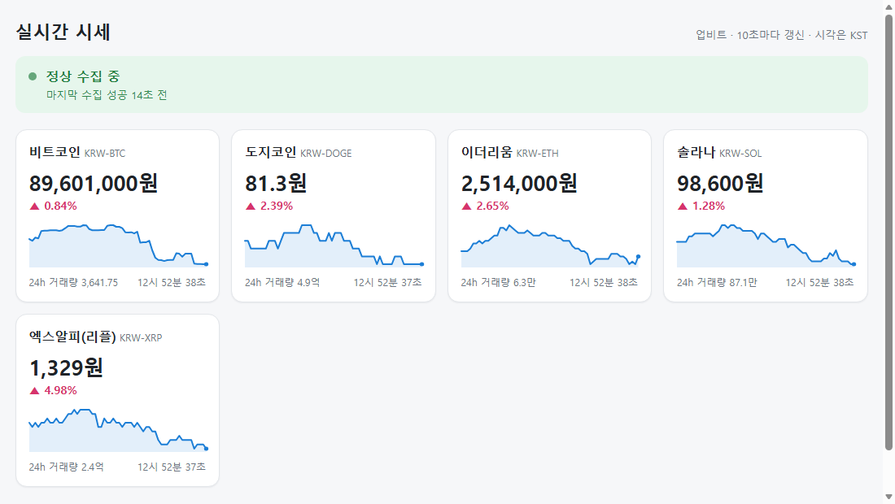

`GET /api/v1/prices`: 화면이 읽어 오는 데이터. 가격은 문자열, 시각은 UTC(`Z`)다.

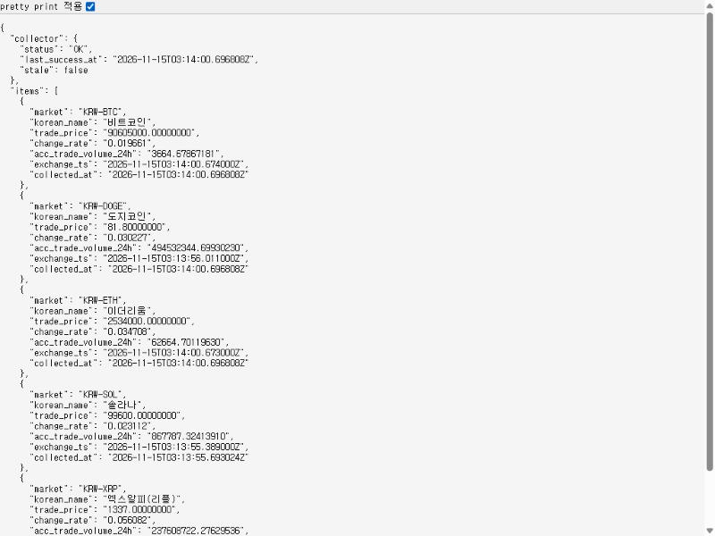

| `GET /api/v1/collector/status` | `GET /api/v1/prices/KRW-NOPE` (404) |
| --- | --- |
| 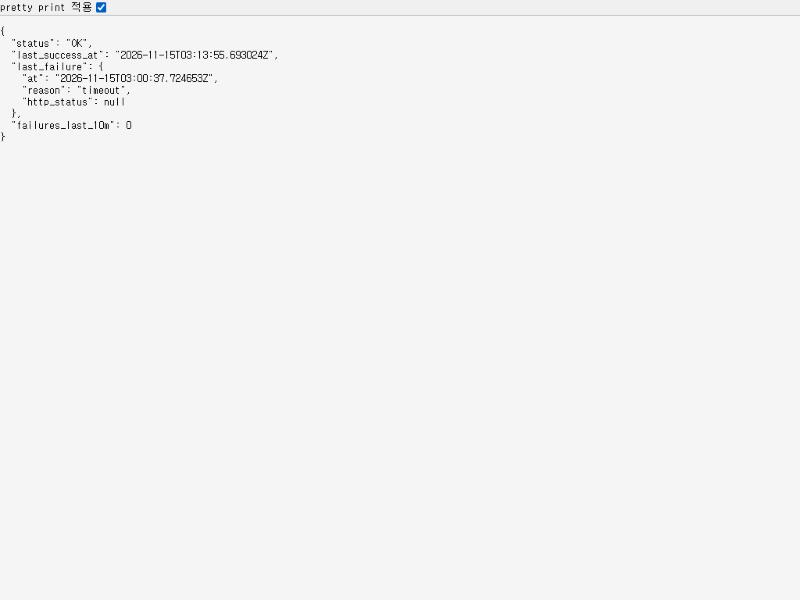 | 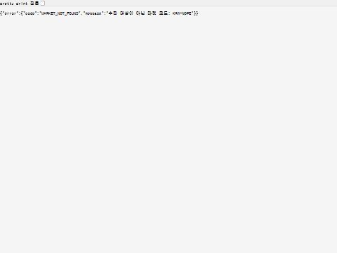 |

`/metrics`: 수집·조회 메트릭. 사유별 실패 카운터가 0으로 미리 잡혀 있고, `http_requests_total`의 `path`가 라우트 템플릿으로 기록된다. `path="unmatched"`는 브라우저가 자동으로 요청한 `/favicon.ico`다.

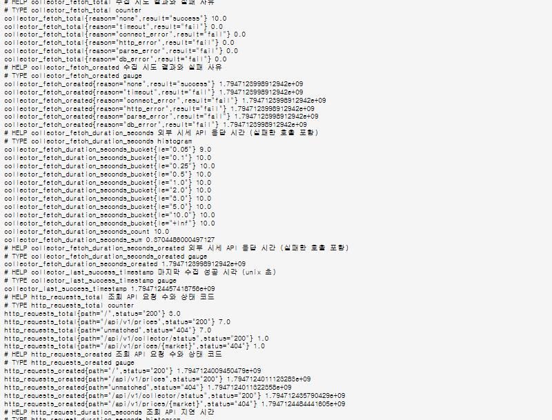

**외부 API 장애 재현** (`UPBIT_TICKER_PATH=/v1/ticker-wrong`, 1분 경과)

조회는 계속 200으로 응답한다. 화면 상단 배너가 빨간색으로 바뀌어 실패 사유(`http_error 404`), 마지막 성공 후 경과 시간, 최근 10분 실패 횟수를 보여 주고, 카드는 흐려진다. 같은 정보가 상태 API에도 남는다.

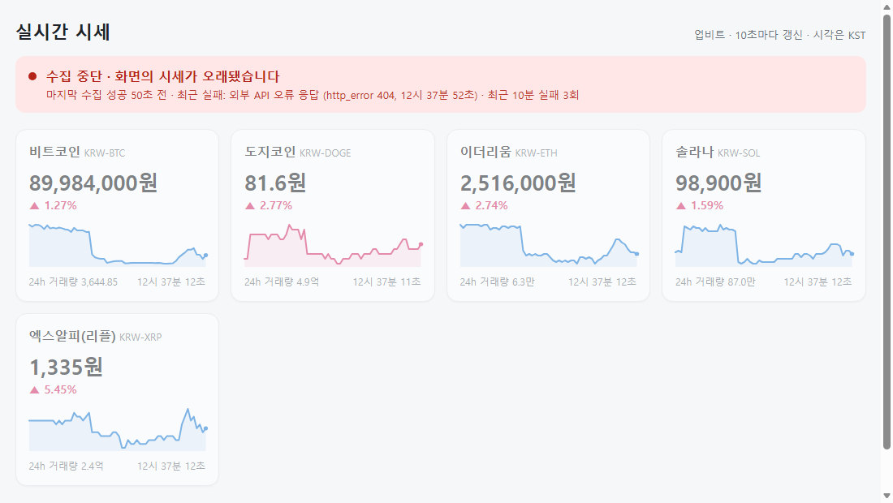

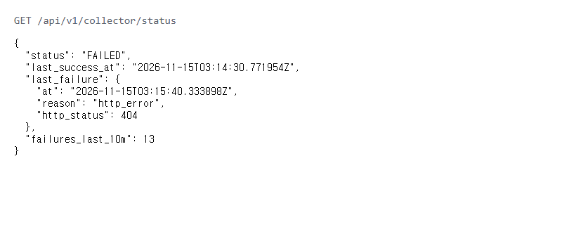

**복구** (정상 설정으로 재시작)

재시작 직후에는 RECOVERED(파랑)로 최근 실패 정보를 남겨 두고, 3번 연속 성공하면 OK(초록)로 돌아간다.

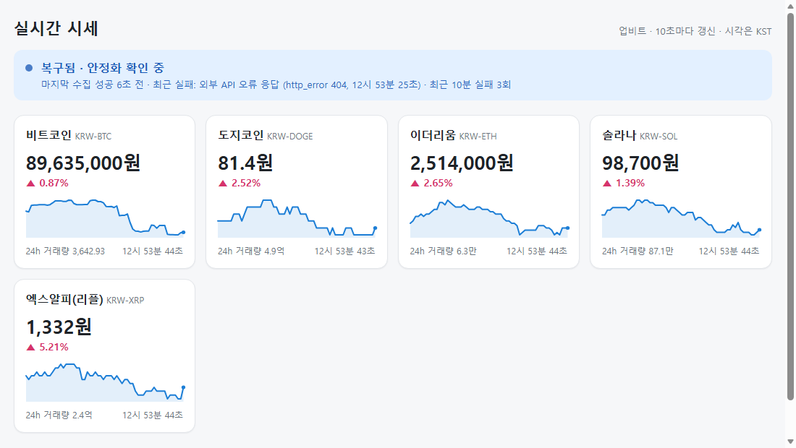

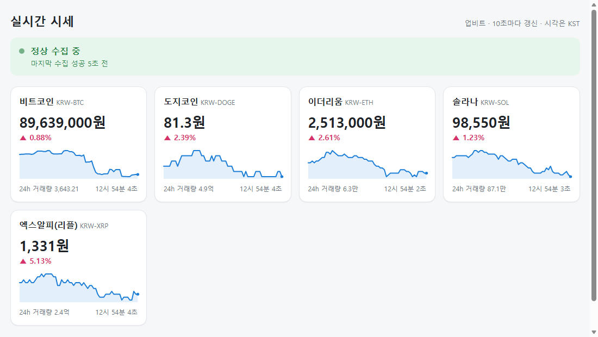

**다크 모드** (운영체제 설정을 따름)

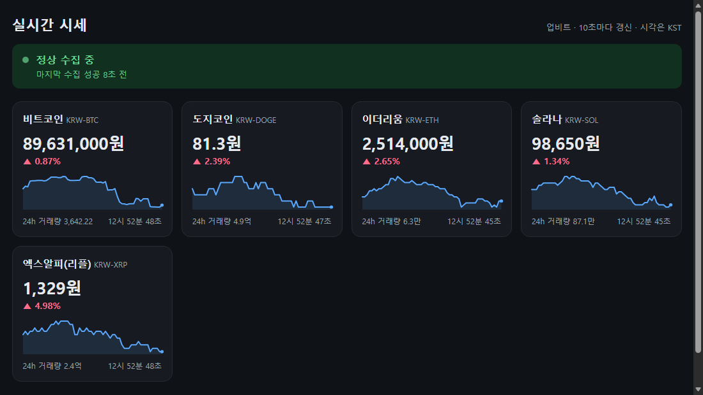

프론트는 ALB가 `/`와 `/api/*`만 앱으로 보내는 제약 때문에 CSS·JS·그래프를 모두 `static/index.html` 한 파일에 넣었다. 꺾은선은 외부 라이브러리 없이 SVG로 그리며, 처음 열 때만 history API로 최근 60개 시세를 받고 이후에는 새 시세를 이어 붙인다. 그래프 색은 최근 약 10분의 흐름, ▲▼ 색은 전일 대비 기준이라 서로 다를 수 있다.

### 4.4 검증하지 못한 것

- **Docker 이미지 빌드와 `docker compose up`**: 이 PC에 Docker가 없어 확인하지 못했다. 처음 실행할 때 확인이 필요하다.
- **실제 AWS Network Firewall에서의 차단**: 응답 없는 주소로 timeout을 흉내 냈을 뿐이다. 실제 방화벽에서 TLS SNI 기반 drop이 `timeout`과 `connect_error` 중 어느 쪽으로 나오는지는 AWS에서 확인해야 한다.
- **업비트 호출 제한(429)**: 실제로 한도를 넘겨 보지는 않았다. 429가 `http_error`로 분류되는 것은 단위 테스트로만 확인했다.
- **부하 테스트**: 아직 하지 않았다.

## 5. 진행 중 겪은 문제

| 문제 | 원인 | 해결 |
| --- | --- | --- |
| 임시 PostgreSQL 연결 실패: `invalid value for parameter "TimeZone": "UTC"` | 연결 옵션으로 세션 시간대를 UTC로 지정했는데, 이 PostgreSQL 배포판에 시간대 데이터가 없었다 | 옵션을 뺐다. `timestamptz`는 DB 안에서 항상 UTC로 저장되고, 응답으로 내보낼 때 UTC로 바꾸므로 필요 없는 설정이었다 |
| 잘못된 경로 재현인데 `connect_error`(DNS 실패)가 나옴 | Git Bash가 환경변수 값 `/v1/ticker-wrong`을 Windows 경로(`C:/Program Files/Git/...`)로 바꿔 URL이 깨졌다 | 앱 문제가 아니었다. `MSYS_NO_PATHCONV=1`로 경로 변환을 끄고 다시 실행해 `http_error`를 확인했다. Docker의 `.env`로 넘길 때는 생기지 않는다 |

## 6. 다음 단계

- Docker Compose로 실행 확인 (`cd app && docker compose up -d --build`)
- Prometheus 수집 설정과 알림 규칙 작성 (`monitoring/`)
- EC2 배포 후 실제 방화벽에서 네트워크 차단 재현, `timeout`·`connect_error` 중 어느 쪽으로 나오는지 기록
- 부하 테스트로 정상 기준선 측정 후 High5xx·HighLatency 임계값 확정
