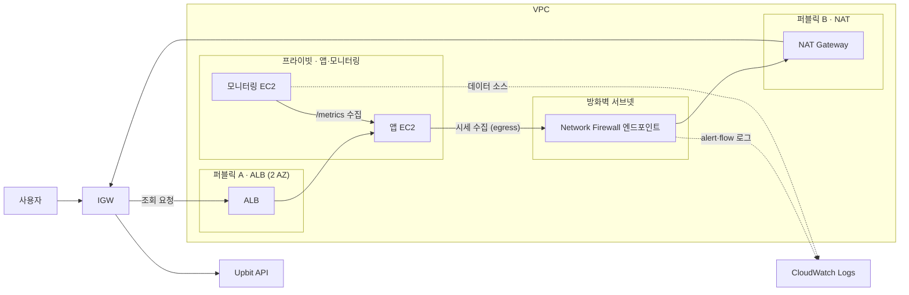
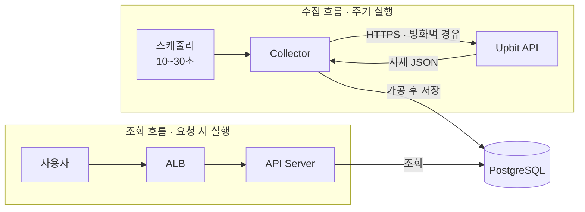
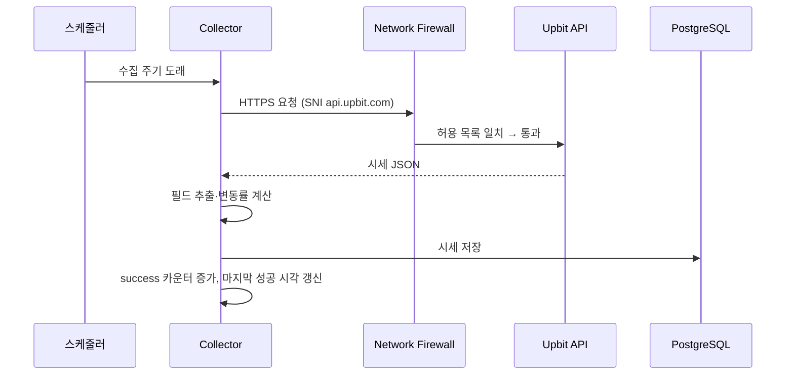
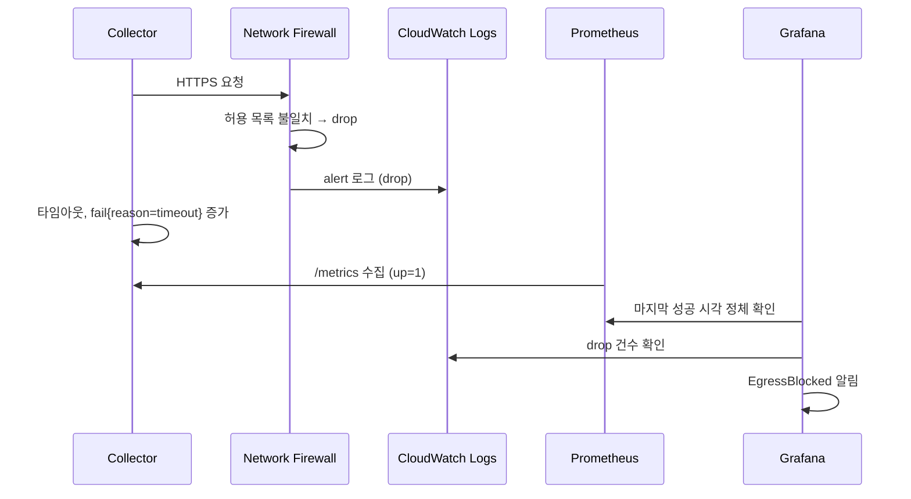
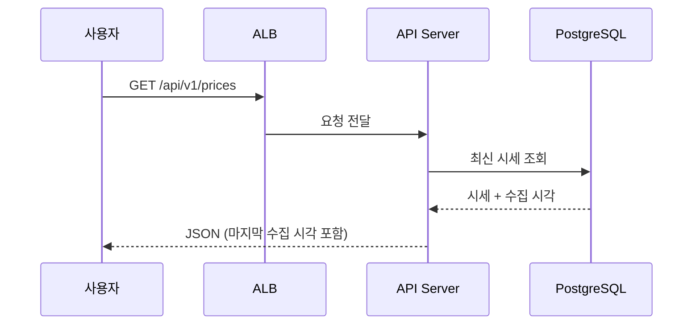
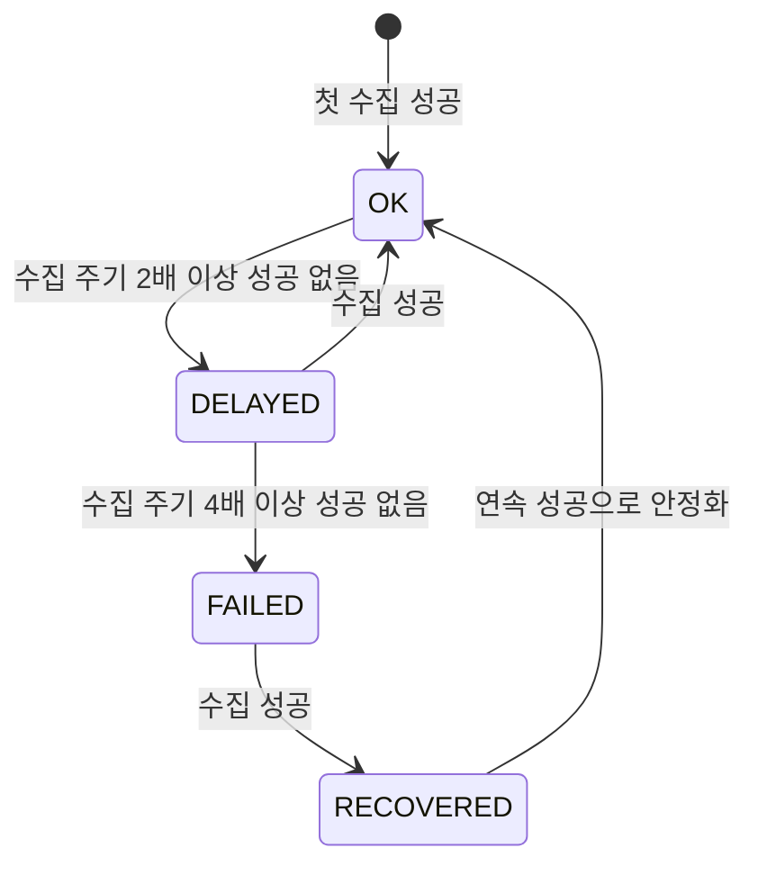

# AWS 네트워크 장애 관제 랩 — 아키텍처 설계

> 관련 문서: [API 명세](api.md) · [데이터 모델(ERD)](erd.md)

## 1. 아키텍처 개요

### 1.1 설계 목적

본 프로젝트는 코인 시세 조회 서비스를 AWS에 올리고, 네트워크·방화벽·앱에서 생기는 장애를 모니터링으로 감지하고 원인을 구분하는 것을 목표로 한다. 서비스 자체는 검증 수단이며, 외부 API에 계속 의존하는 구조라서 egress 통제와 장애 감지를 실험하기에 적합하다.

검증할 기술 목표는 다음과 같다.

- Terraform으로 VPC·서브넷·라우팅·AWS Network Firewall 구성
- 외부로 나가는 트래픽(egress)을 도메인 허용 목록으로 통제
- 앱 메트릭·방화벽 로그 수집과 Grafana 대시보드·알림 구성
- 장애 상황을 재현하고, 지표만으로 원인을 구분
- 부하 테스트(가상 사용자)로 정상 상태 기준선 확보

### 1.2 주요 설계 원칙

- 수집 흐름과 조회 흐름을 분리한다. 외부 API가 멈춰도 조회는 계속 제공한다.
- **외부 API 장애, 방화벽 차단, 앱 자체 장애를 구분한다.** 지표 조합으로 원인을 판별할 수 있게 메트릭을 설계한다.
- 앱 서버는 프라이빗 서브넷에 두고, 외부로 나가는 모든 트래픽은 방화벽을 거친다.
- 모든 인프라는 Terraform으로 만들고 지운다. 콘솔 수동 변경은 하지 않는다.
- 기술적 필요만으로 MVP 범위를 넓히지 않는다. 단일 AZ, 단일 앱 서버로 시작한다.

## 2. 컴포넌트 구성

앱은 Collector와 API Server 두 책임으로 나누되, MVP에서는 하나의 FastAPI 프로세스 안에서 실행한다. 코드와 메트릭은 처음부터 분리해 두어 나중에 컨테이너를 나눌 수 있게 한다.

| 구성 요소 | 위치 | 주요 책임 |
| --- | --- | --- |
| Collector | 앱 EC2 (FastAPI 백그라운드 작업) | 10~30초 주기로 외부 코인 API 호출, 필요한 필드만 가공, DB 저장, 수집 메트릭 기록 |
| API Server | 앱 EC2 (FastAPI) | 시세 조회 API, 프론트 HTML 서빙, `/health`·`/metrics` 제공 |
| DB | 앱 EC2 (PostgreSQL 컨테이너) | 시세 이력·수집 이력 저장 |
| Monitoring | 모니터링 EC2 | Prometheus(메트릭), Grafana(대시보드·알림), CloudWatch 데이터 소스 연결 |
| Network Firewall | 방화벽 서브넷 | egress 도메인 허용 목록, 차단·허용 로그를 CloudWatch Logs로 전송 |
| Load Generator | 로컬 PC 또는 별도 EC2 | Locust/k6로 가상 사용자 트래픽 생성 |

외부 API는 우선 Upbit 공개 시세 API(`api.upbit.com`)를 기준으로 한다. 인증 없이 호출할 수 있고 도메인이 하나라 방화벽 규칙을 설명하기 쉽다. 호출 제한은 구현 전에 공식 문서로 확인한다.

## 3. 시스템 구성

앱과 모니터링 서버는 프라이빗 서브넷에 두고, 외부로 나가는 트래픽은 방화벽 → NAT → IGW 순서로만 나간다.

조회 요청은 ALB에서 앱으로 바로 들어오고, 시세 수집만 방화벽을 거친다. 그래서 방화벽 규칙을 바꿔도 조회는 살아 있고 수집만 멈추는 장애를 만들 수 있다.

### 3.1 라우팅

| 서브넷 | 목적지 | 대상 |
| --- | --- | --- |
| 프라이빗 (앱·모니터링) | 0.0.0.0/0 | 방화벽 엔드포인트 |
| 방화벽 | 0.0.0.0/0 | NAT Gateway |
| 퍼블릭 B (NAT) | 0.0.0.0/0 | IGW |
| 퍼블릭 B (NAT) | 프라이빗 서브넷 CIDR | 방화벽 엔드포인트 (돌아오는 응답도 방화벽 경유) |
| 퍼블릭 A (ALB) | 0.0.0.0/0 | IGW |

퍼블릭 서브넷을 ALB용과 NAT용으로 나눈 이유는 라우팅 테이블 때문이다. 하나로 합치면 프라이빗 CIDR을 방화벽으로 보내는 규칙이 ALB → 앱 트래픽에도 걸린다. 또 ALB는 최소 2개 AZ의 서브넷이 필요하므로, 단일 AZ 원칙의 예외로 퍼블릭 A만 2개 AZ에 만든다.

## 4. 데이터 흐름

수집과 조회는 DB를 사이에 두고 따로 돈다. 사용자 요청은 외부 API를 직접 호출하지 않는다.

| 흐름 | 시작 | 외부 의존 | 막혔을 때 사용자가 보는 것 |
| --- | --- | --- | --- |
| 수집 | 스케줄러 | Upbit API, 방화벽, NAT | 조회는 되지만 시세가 갱신되지 않음 |
| 조회 | 사용자 요청 | 없음 (ALB, 앱, DB만) | 페이지 오류 또는 응답 지연 |

조회 응답에는 마지막 수집 시각을 포함해, 화면에서도 데이터가 오래됐는지 보이게 한다.

## 5. 장애 분류와 감지 기준

장애는 하나의 지표가 아니라 지표 조합으로 구분한다. 핵심은 "앱은 살아 있는데 수집만 멈춘 경우"에서 원인이 방화벽인지 외부 API인지 가르는 것이다.

### 5.1 장애 유형

| 유형 | 재현 방법 | 앱 상태(`up`) | 수집 실패 사유 | 방화벽 로그 |
| --- | --- | --- | --- | --- |
| 네트워크 차단 | 허용 목록에서 `api.upbit.com` 제거 | 1 (정상) | `timeout`·`connect_error` | 해당 도메인 drop 기록 |
| 외부 API 장애 | 잘못된 엔드포인트·과다 호출(429) | 1 (정상) | `http_error` (4xx·5xx) | drop 없음 |
| 앱 장애 | 컨테이너 중지, 예외 주입 | 0 또는 5xx 급증 | 수집 자체 중단 | drop 없음 |
| 데이터 장애 | 응답 파싱 실패, 빈 값 저장 | 1 (정상) | `parse_error` | drop 없음 |
| 성능 저하 | 부하 테스트로 동시 사용자 증가 | 1 (정상) | 없음 | drop 없음 |

### 5.2 핵심 메트릭

| 메트릭 | 종류 | 의미 |
| --- | --- | --- |
| `collector_fetch_total{result, reason}` | Counter | 수집 시도 결과와 실패 사유 |
| `collector_fetch_duration_seconds` | Histogram | 외부 API 응답 시간 |
| `collector_last_success_timestamp` | Gauge | 마지막 수집 성공 시각 |
| `http_requests_total{path, status}` | Counter | 조회 API 요청 수와 상태 코드 |
| `http_request_duration_seconds{path}` | Histogram | 조회 API 지연 시간 |
| `up{job="app"}` | Gauge | Prometheus가 앱을 수집할 수 있는지 |

방화벽 drop은 CloudWatch Logs 메트릭 필터로 건수를 만들고 Grafana의 CloudWatch 데이터 소스로 같은 대시보드에 올린다.

### 5.3 알림 규칙 (초안)

| 알림 | 조건 | 우선 의심할 원인 |
| --- | --- | --- |
| CollectorStale | 마지막 수집 성공 후 수집 주기의 4배 이상 경과 | 사유별 실패 건수로 판별 |
| EgressBlocked | `reason=timeout` 증가 + 방화벽 drop 존재 | 방화벽 규칙 |
| UpstreamError | `reason=http_error` 증가, drop 없음 | 외부 API |
| AppDown | `up == 0`이 1분 지속 | 앱 프로세스·EC2 |
| High5xx / HighLatency | 조회 API 5xx 비율 또는 p95 지연이 기준 초과 | 앱·DB 성능 |

임계값(5xx 비율, p95 지연)은 부하 테스트로 정상 기준선을 잰 뒤 정한다.

## 6. 배포 구성

인프라는 Terraform 모듈로, 앱과 모니터링은 각 EC2의 Docker Compose로 배포한다.

| 항목 | 구성 |
| --- | --- |
| Terraform 모듈 | `network`(VPC·서브넷·IGW·NAT·라우팅), `firewall`(정책·규칙 그룹·로깅), `compute`(EC2·보안 그룹·IAM), `alb`, `observability`(로그 그룹·메트릭 필터) |
| 앱 EC2 | Docker Compose: `app`(FastAPI + Collector), `db`(PostgreSQL) |
| 모니터링 EC2 | Docker Compose: Prometheus, Grafana |
| 접속 | SSH 포트 개방 없이 SSM Session Manager, Grafana는 SSM 포트 포워딩으로 접속 |
| 설정·비밀 값 | DB 비밀번호는 SSM Parameter Store, Git에 올리지 않음 |
| 상태 파일 | Terraform state는 S3 백엔드(실습 종료 후 `destroy`) |

허용 목록에는 Upbit 외에도 패키지 설치·이미지 내려받기에 필요한 도메인(OS 패키지 저장소, Docker Hub, GitHub 등)이 들어가야 한다. 어떤 도메인이 필요했는지 찾는 과정을 트러블슈팅 기록으로 남긴다. SSM 엔드포인트도 방화벽을 거치므로 허용하거나 VPC 엔드포인트를 둔다.

## 7. 핵심 흐름

### 7.1 정상 수집

### 7.2 방화벽 차단 시

### 7.3 조회

### 7.4 수집 상태

상태의 소유자는 Collector다. DELAYED는 경고 대시보드 표시만, FAILED부터 알림을 보낸다. 주기 배수는 실제 수집 간격을 정한 뒤 확정한다. API 응답에서의 사용은 [API 명세](api.md#92-응답-예시)를 참고한다.

## 8. 구현 범위와 추후 확장

MVP는 단일 AZ·단일 앱 서버에서 장애 분류와 감지까지 동작하는 것을 목표로 한다.

| 구분 | 항목 |
| --- | --- |
| MVP 포함 | Terraform 네트워크·방화벽, 앱(수집·조회), Prometheus·Grafana, 방화벽 로그 연동, 장애 재현 4종, 부하 테스트 |
| 범위 제외 | 로그인·회원, 거래 기능, 인바운드 트래픽의 방화벽 검사, Multi-AZ |
| 추후 확장 | Collector 별도 컨테이너 분리, RDS 전환, Loki 중앙 로그, Multi-AZ 방화벽 엔드포인트, ALB 앞 WAF |

열린 질문:

- [ ] 수집 간격 10초 vs 30초 — Upbit 호출 제한과 비용(NAT·방화벽 처리량) 확인 후 결정
- [ ] 수집 대상 코인 개수
- [ ] Network Firewall 시간당 요금 — 실습할 때만 올리고 끝나면 destroy
