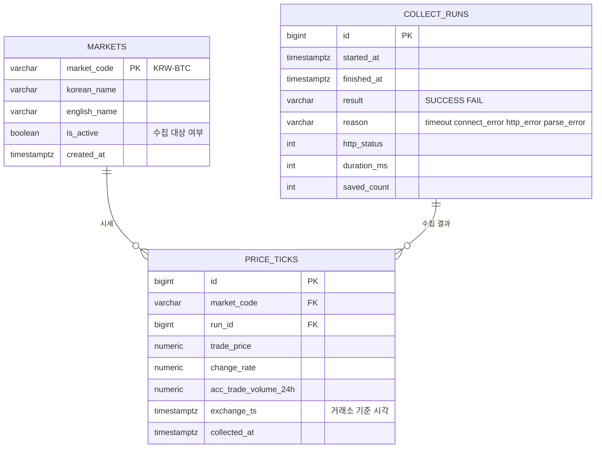

# 데이터 모델 (ERD)

> 관련 문서: [아키텍처 설계](architecture.md) · [API 명세](api.md)

DB는 시세만 저장하지 않고 **수집 시도 이력**도 함께 저장한다. 메트릭은 "지금 실패하고 있다"를 보여주고, 수집 이력은 "언제부터 어떤 이유로 몇 번 실패했고 어느 구간 데이터가 비었는지"를 장애 보고서에 남기는 근거가 된다.

## 1. 테이블 정의

| 테이블 | 역할 | 키·제약 |
| --- | --- | --- |
| `markets` | 수집 대상 코인 목록. `is_active`로 수집에서 빼고 넣음 | PK `market_code` |
| `collect_runs` | 수집 주기 1회 = 1행. 성공·실패 모두 기록 | `result` 값 제한, 실패 시 `reason` 필수 |
| `price_ticks` | 코인별 시세 스냅샷 | UNIQUE(`market_code`, `exchange_ts`)로 중복 저장 방지, 인덱스(`market_code`, `collected_at` DESC) |

- 가격은 `float`가 아닌 `numeric`으로 저장해 소수점 오차를 막는다.
- 시각은 모두 `timestamptz`(UTC 저장)로 두고, 화면에서만 KST로 바꾼다.
- `exchange_ts`와 `collected_at`을 따로 두면 "거래소 데이터가 늦은 것"과 "우리 수집이 늦은 것"을 구분할 수 있다.
- 컬럼 이름은 Upbit ticker 응답 필드를 따랐고, 구현 전에 공식 문서로 확인한다.

## 2. 테이블 정의서

**markets** — 수집 대상 코인 목록

| 컬럼 | 타입 | 키 | NULL | 기본값 | 설명 |
| --- | --- | --- | --- | --- | --- |
| market_code | varchar(20) | PK | N |  | 마켓 코드 (예: KRW-BTC) |
| korean_name | varchar(50) |  | N |  | 한글 이름 |
| english_name | varchar(50) |  | Y |  | 영문 이름 |
| is_active | boolean |  | N | true | 수집 대상 여부 |
| created_at | timestamptz |  | N | now() | 등록 시각 |

**collect_runs** — 수집 1회당 1행

| 컬럼 | 타입 | 키 | NULL | 기본값 | 설명 |
| --- | --- | --- | --- | --- | --- |
| id | bigserial | PK | N | 자동 증가 | 수집 회차 식별자 |
| started_at | timestamptz |  | N | now() | 수집 시작 시각 |
| finished_at | timestamptz |  | Y |  | 수집 종료 시각 (진행 중이면 NULL) |
| result | varchar(10) |  | N |  | SUCCESS 또는 FAIL |
| reason | varchar(20) |  | Y |  | 실패 사유: timeout, connect_error, http_error, parse_error |
| http_status | smallint |  | Y |  | 외부 API 응답 코드 (응답이 없으면 NULL) |
| duration_ms | integer |  | Y |  | 외부 API 호출에 걸린 시간 |
| saved_count | integer |  | N | 0 | 이 회차에 저장한 시세 행 수 |

**price_ticks** — 코인별 시세 스냅샷

| 컬럼 | 타입 | 키 | NULL | 기본값 | 설명 |
| --- | --- | --- | --- | --- | --- |
| id | bigserial | PK | N | 자동 증가 | 행 식별자 |
| market_code | varchar(20) | FK → markets | N |  | 마켓 코드 |
| run_id | bigint | FK → collect_runs | N |  | 이 시세를 저장한 수집 회차 |
| trade_price | numeric(20,8) |  | N |  | 현재가 |
| change_rate | numeric(10,6) |  | Y |  | 전일 대비 변동률 |
| acc_trade_volume_24h | numeric(30,8) |  | Y |  | 24시간 누적 거래량 |
| exchange_ts | timestamptz |  | N |  | 거래소 기준 시각 |
| collected_at | timestamptz |  | N | now() | 우리 서버가 수집한 시각 |

**제약 조건과 인덱스**

| 테이블 | 종류 | 내용 | 이유 |
| --- | --- | --- | --- |
| collect_runs | CHECK | `result IN ('SUCCESS','FAIL')` | 허용된 결과만 저장 |
| collect_runs | CHECK | `reason IN ('timeout','connect_error','http_error','parse_error')` | 메트릭 `reason` 레이블과 값을 맞춤 |
| collect_runs | CHECK | 성공이면 `reason`은 NULL, 실패면 NOT NULL | 실패인데 사유가 비는 행 방지 |
| collect_runs | INDEX | `(started_at DESC)` | 최근 수집 상태 조회 |
| price_ticks | UNIQUE | `(market_code, exchange_ts)` | 같은 시각 시세 중복 저장 방지 |
| price_ticks | INDEX | `(market_code, collected_at DESC)` | 최신 시세·이력 조회 |
| price_ticks | FK | 두 FK 모두 `ON DELETE RESTRICT` | 시세가 남아 있는 코인·수집 이력은 삭제 불가 |

보관 기간이 시세 7일, 수집 이력 30일이라 시세가 항상 먼저 지워지므로 RESTRICT와 충돌하지 않는다. 코인을 수집에서 빼려면 행을 지우지 않고 `is_active`를 false로 바꾼다.

## 3. 보관 정책

`price_ticks`는 코인 10개를 10초마다 수집하면 하루 86,400행이 쌓인다. MVP에서는 7일이 지난 행을 하루 한 번 삭제하고, `collect_runs`는 장애 분석용으로 30일 보관한다.
